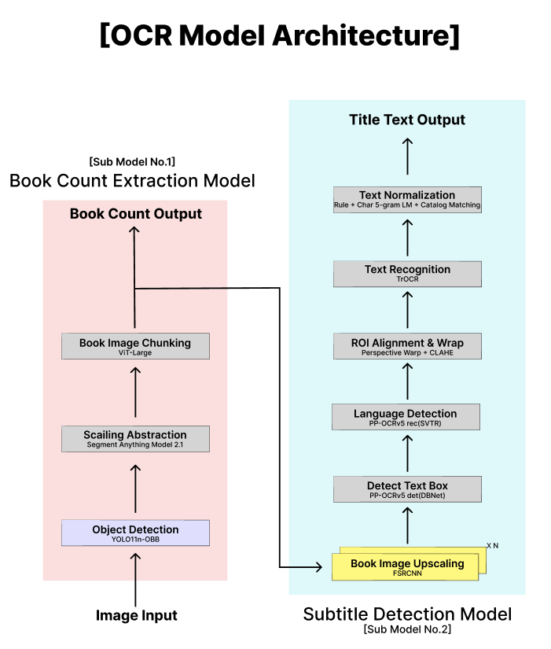
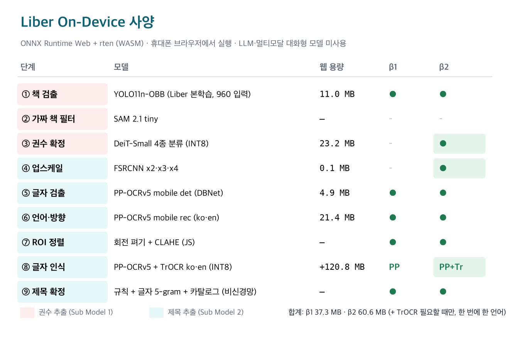

# Liber Deprehensus

책장 사진 한 장에서 **책 권수**와 **책 제목**을 뽑아내는 On-Device 모델입니다.
모든 단계가 휴대폰 브라우저 안에서 실행되며, **LLM·멀티모달 대화형 모델은 쓰지 않습니다.**
쓰는 모델은 모두 이미지만 입력받는 단일 목적 비전 모델(검출·분류·초해상도·OCR)이고, 제목 교정은 비신경망 규칙과 n-gram입니다.

- 웹 데모: <https://skytinstone.github.io/shelf-ocr-ondevice/app.html> (Chrome 권장)
- 웹앱 코드: [`web/app.html`](web/app.html) · PC 노트북: [`liber_deprehensus/liber_deprehensus.ipynb`](liber_deprehensus/liber_deprehensus.ipynb) · 모델 상세: [`liber_deprehensus/README.md`](liber_deprehensus/README.md)

---

## 1. 한눈에 보기

| 항목 | 내용 |
|---|---|
| 입력 / 출력 | 책장·책상·진열대 사진 1장 → 책 권수 + 책마다 제목 (카탈로그 확정 / 글자로 읽음 / 미인식) |
| 실행 환경 | 휴대폰 브라우저 (ONNX Runtime Web 1.20.1 + rten, WASM). 사진은 서버로 보내지 않음 |
| 버전 | **β1** = 책 검출 + 글자 단계 · **β2** = β1 + 권수 확정(ViT) + 업스케일(FSRCNN) + TrOCR 보조 인식 |
| 모델 용량 (웹) | β1 **37.3MB** · β2 **60.6MB** (+ TrOCR 한국어 56.9MB / 영어 63.9MB, 필요할 때 한 언어씩) |
| 실행 엔진 | ONNX Runtime WASM 11.3MB + rten WASM 2.5MB |
| 성능 (시험 세트 9장) | 제목 재현율 β1 48.7% → **β2 56.6%** (상대 +16.2%) · 권수 정확도 87.9% |

## 2. 모델 구조

설계한 전체 구조 (권수 추출 Sub Model 1 + 제목 추출 Sub Model 2):

<p align="center"></p>

웹(On-Device)에 실제로 올린 사양과 버전별 적용 범위:

<p align="center"></p>

| 단계 | 하는 일 | 모델 | β1 | β2 |
|---|---|---|:-:|:-:|
| ① 책 검출 | 회전 상자로 책등·표지 찾기 | YOLO11n-OBB (Liber 본학습, 960 입력, 신뢰도 0.45) | ✅ | ✅ |
| ② 가짜 책 필터 | 마스크로 가짜 상자 거르기 | SAM 2.1 tiny | PC만 | PC만 |
| ③ 권수 확정 | book / not_book / partial / multiple 판정 → 나누기·합치기·버리기 | DeiT-Small (PC는 ViT-Large) | – | ✅ |
| ④ 업스케일 | 폭이 좁은 책등만 2~4배 | FSRCNN | – | ✅ |
| ⑤ 글자 검출 | 책 안의 글자 줄 찾기 | PP-OCRv5 mobile det (DBNet) | ✅ | ✅ |
| ⑥ 언어·방향 | 줄마다 0°·180°·90°·세로쓰기 중 고르기 | PP-OCRv5 mobile rec (한국어·영어) | ✅ | ✅ |
| ⑦ ROI 정렬 | 줄 사각형 펴기 + 여백 + CLAHE | (JS 영상 처리) | ✅ | ✅ |
| ⑧ 글자 인식 | 줄 글자 읽기 | PP-OCRv5 (β2는 애매한 제목 줄만 TrOCR로 한 번 더) | PP | PP + TrOCR |
| ⑨ 제목 확정 | 저자·출판사·판수 제외 → 단어 교정·어순 → 카탈로그 매칭 | 규칙 + 글자 5-gram KN + 자모 편집거리 | ✅ | ✅ |

β2에서 TrOCR은 **카탈로그로 확정되지 않은 책의, PP-OCR 확신이 0.9보다 낮은 제목 줄만** 다시 읽고 두 인식기 중 확신이 높은 쪽을 씁니다.
SAM 2(②)는 휴대폰 메모리 때문에 웹에는 넣지 않았습니다.

## 3. 성능

### β1 · β2 비교 (고정 시험 세트: 사진 9장 · 정답 제목 113개)

| 지표 | β1 | β2 | 변화 |
|---|--:|--:|--:|
| 제목 재현율 (정답 제목 중 맞힌 비율) | 48.7% | **56.6%** | +7.9%p (상대 +16.2%) |
| 제목 정밀도 (읽어 낸 제목 중 맞은 비율) | 49.1% | **54.7%** | +5.6%p (상대 +11.4%) |
| 제목 F1 | 48.9% | **55.7%** | +6.8%p (상대 +13.9%) |
| 권수 정확도 (1 − 권수 오차 ÷ 정답 권수) | 87.9% | 87.9% | 같음 |
| 평균 처리 시간 (사진 1장, PC Chrome) | 31.6초 | 41.8초 | +10.2초 |

- 정답 파일: [`eval/gt.json`](eval/gt.json) (사진별 권수·제목, 일부 사진은 셀 영역 ROI 지정)
- 제목은 정답과 글자 유사도 80% 이상이면 맞음
- 측정: PC의 Chromium(아이폰 14 Pro 화면 크기)에서 웹앱을 자동 실행. 실제 휴대폰은 시간이 더 걸림

### 제거 실험 (무엇이 효과가 있었나)

| β2 구성 (7장) | 제목 재현율 |
|---|--:|
| β1 | 46.7% |
| β2 − 업스케일(FSRCNN) | 37.8% |
| β2, 방향을 책 단위로 한 번만 결정 | 46.7% |
| **β2 (방향은 줄마다)** | **56.7%** |

| β2 구성 (9장) | 제목 재현율 | 시간 |
|---|--:|--:|
| β2 − TrOCR | 56.6% | 37.5초 |
| β2 + TrOCR | 56.6% | 41.8초 |

- β2의 향상은 대부분 **FSRCNN 업스케일**에서 나옵니다. 작은 글씨 책장(사전·자격증·영어 원서)에서 효과가 큽니다.
- 이 시험 세트에서는 TrOCR이 수치를 바꾸지 못했습니다(애매한 줄이 적음). 그래도 β2에는 켜 두었습니다.

### 검출 규칙의 효과 (내 사진 시험용 6장, 권수 오차 합)

| 검출기 | 규칙 켬 | 규칙 끔 |
|---|--:|--:|
| 본학습 검출기 (사용 중) | **10** | 11 |
| 실제 사진 미세조정 검출기 | 11 | 12 |

규칙 = 사진 가장자리 빈 배경 띠 제거, 가장자리 띠는 글자가 실제로 읽힐 때만 책으로 인정 등. 두 검출기 모두 규칙이 오차를 줄였습니다.

## 4. 학습 기록

### 단계 요약

| 단계 | 대상 | 환경 | 결과 | 채택 |
|---|---|---|---|---|
| 0. 사전학습 가중치 | YOLO11n-OBB(DOTA), DeiT-Small·ViT-Large(ImageNet), PP-OCRv5, TrOCR, FSRCNN | 공개 가중치 | – | – |
| 1. 본학습 | ① 책 검출기 · ③ 권수 분류기 | Colab A100 80GB · RAM 167GB | 웹 `e_unified.onnx` · `liber_vit_small_int8.onnx` | ✅ |
| 2-a. 합성 사진 미세조정 | ① 책 검출기 | Colab A100 | 실제 사진 7장에서 권수가 틀린 사진 2장 → 4장 | ✗ |
| 2-b. 실제 사진 미세조정 | ① 책 검출기 | Colab A100 | 시험 6장 권수 오차 합 11 → 11 (같음) | ✗ |
| 3. 경량화 (배포) | ViT·TrOCR INT8 (MatMul·Gather만), FSRCNN·TrOCR ONNX 변환 | 맥 | 원본과 결과 일치 확인 | ✅ |

강화학습은 쓰지 않았습니다. 양자화는 학습 후 변환(PTQ)이라 배포 단계에 해당합니다.

### 1. 본학습 — ① 책 검출기 (YOLO11n-OBB)

| 항목 | 값 |
|---|---|
| 데이터 출처 | Roboflow Universe 책등 프로젝트 4개 (CC BY 4.0) · Open Images V7 책 사진 (권수 구간별 최대 4,500장) · 이전 프로젝트 합성·실사 약 2,660장 · 1~3권 장면 보강 (책장 사진에서 오린 1~3권, 최대 3,000장 × 2회) |
| 학습 사진 | 에폭당 약 **19,300장** (604배치 × 32, 반복·증강 포함, 실측) |
| 검증 사진 | **827장 · 책 8,949권** (실측) |
| 설정 | 입력 960 · 배치 32 · 최대 150에폭 · patience 20 · 회전 ±30° · 좌우 반전 · mosaic (마지막 15에폭 끔) · `cache="disk"` |
| 1에폭 시간 | 약 **2분 45초** (학습 2:31 + 검증 15초, 실측) · GPU 메모리 21~29GB |
| 1에폭 검증 | P 0.80 · R 0.73 · mAP50 0.78 · mAP50-95 0.50 |
| 최종 검증 · 실제 에폭 수 · 총 학습 시간 | **확인 필요** (Colab `results.csv`에서 채우기) |
| 웹 신뢰도 기준 | 0.45 (Colab에서 0.15~0.60을 훑어 권수 구간별 정확도가 가장 높은 값) |
| 웹 모델 | `e_unified.onnx` FP32 11.0MB (PyTorch `det_obb_best.pt` 5.6MB) |

### 1. 본학습 — ③ 권수 분류기 (ViT 4종)

| 항목 | 값 |
|---|---|
| 분류 | book · not_book · partial(잘린 조각) · multiple(여러 권 덩어리) |
| 데이터 | 검출 학습 데이터의 정답 상자에서 자동 생성 + 책 없는 장면(Open Images 2,500장 × 4조각) + Kaggle 표지 6,000장 (설정값, 약 9.4만 조각 예상) |
| 모델 | ViT-Large in21k (PC, 30에폭, lr 3e-5, 배치 64) · **DeiT-Small** (웹, 50에폭, lr 1e-4, 배치 256) · 입력 224 레터박스 |
| 검증 정확도 · 학습 시간 | **확인 필요** |
| 웹 모델 | `liber_vit_small_int8.onnx` 23.2MB (FP32 86.8MB → MatMul INT8. 무작위 입력 20개에서 FP32와 판정 20/20 일치) |

### 2-b. 실제 사진 미세조정 (채택 안 함)

| 항목 | 값 |
|---|---|
| 라벨 | 직접 찍은 사진 **21장**을 Roboflow(`liber-books`)에서 라벨링 — SAM 3 자동 라벨로 초안 → 사람이 검토·수정 |
| 나눔 | 학습 15장 (× 20회 반복) · 시험 6장 (IMG_1530 · 1545 · 1587 · 1591 · 1592 · 1593) |
| 추가 학습 데이터 | 실제 사진 조각으로 만든 합성 1,500장 · 책 없는 배경 200장 |
| 설정 | 본학습 가중치에서 시작 · SGD lr0 0.002 · 30에폭 · patience 10 · 입력 960 |
| 공개 검증 세트 | P 0.931 · R 0.914 · mAP50 0.937 (후반 에폭) |
| 실제 시험 6장 | 권수 오차 합 11 → 11 · 웹 규칙 포함 10 → 11 · 읽은 제목 37 → 40 |
| 결론 | 상자는 더 딱 맞지만 가장자리 띠를 잡는 경우가 생겨 권수가 나아지지 않음 → 본학습 검출기 유지 |

SAM 3는 **라벨링 보조 도구로만** 썼고 Liber 추론에는 들어가지 않습니다.

### 2-a. 합성 사진 미세조정 (채택 안 함)

합성 4,000장 + 확인용 300장 + 책 없는 배경 2,500장, 30에폭. 실제 사진에서 권수가 틀린 사진이 2장에서 4장으로 늘어 채택하지 않았습니다.
배경으로 넣은 건물 사진 때문에 건물 그림이 있는 표지를 책이 아니라고 배운 것으로 추정합니다.

### Colab 사용량

| 항목 | 값 |
|---|---|
| 런타임 | A100 80GB · 시스템 RAM 167GB (고용량) · 로컬 디스크 약 600GB |
| 컴퓨팅 단위 | 시간당 약 6.8개 (고용량 RAM 런타임) · 남은 단위 약 433개 기준으로 시작 |
| 세션 중단 | 1회 (RAM 83.5GB 런타임에서 `cache="ram"` → `disk`로 바꾸고 고용량 RAM으로 전환) |

## 5. 메모리 · 용량

### 웹 모델 파일

| 파일 | 단계 | 용량 | 형식 |
|---|---|--:|---|
| `e_unified.onnx` | ① 책 검출 | 11.0MB | FP32 |
| `liber_vit_small_int8.onnx` | ③ 권수 확정 (β2) | 23.2MB | INT8 (MatMul) |
| `fsrcnn_x2/x3/x4.onnx` | ④ 업스케일 (β2) | 0.11MB | FP32 |
| `e_det.rten` | ⑤ 글자 검출 | 4.9MB | FP32 |
| `ppv5_rec` · `e_en_rec.rten` | ⑥⑧ 한국어 · 영어 인식 | 13.5MB · 7.9MB | FP32 |
| `trocr_ko_enc/dec.onnx` | ⑧ TrOCR 한국어 (β2) | 23.8 + 33.1MB | INT8 (MatMul·Gather) |
| `trocr_en_enc/dec.onnx` | ⑧ TrOCR 영어 (β2) | 23.8 + 40.1MB | INT8 (MatMul·Gather) |

### 실행 중 메모리 (실측)

PC Chromium(아이폰 14 Pro 화면)에서 세계문학 책장 사진(21권)을 처리하는 동안 렌더러 프로세스 메모리(RSS)를 1초마다 쟀습니다.

| 구간 | 최대 메모리 |
|---|--:|
| 페이지만 연 상태 | 약 170MB |
| β1 실행 | 약 **900MB** |
| β1 → β2 연속 실행 (TrOCR 포함) | 약 **1,100MB** |

- 휴대폰 메모리를 아끼려고 β2 모델은 필요한 단계 직전에 불러오고, 끝나면 바로 반납합니다 (ViT는 권수 확정 뒤, FSRCNN·TrOCR은 β2가 끝난 뒤). TrOCR은 한 번에 한 언어만 메모리에 둡니다.
- 메모리가 부족해 β2 모델을 못 불러오면, 실패하지 않고 그 단계만 건너뜁니다.
- 아이폰 브라우저(Safari·Chrome 모두 WebKit)는 탭 메모리 한도가 작습니다. 데모 전에는 탭을 새로 여는 것을 권장합니다.

## 6. 데이터 · 모델 출처

| 이름 | 용도 | 라이선스 |
|---|---|---|
| Roboflow Universe 책등 프로젝트 4개 | 검출 학습 | CC BY 4.0 |
| Open Images V7 | 검출 학습 · not_book 배경 | 주석 CC BY 4.0 · 사진 CC BY 2.0 |
| Kaggle Book Covers | 권수 분류 학습 · 제목 사전 | CC0 (학습에만 사용, 저장소에 넣지 않음) |
| 직접 찍은 사진 21장 | 미세조정 실험 · 시험 | 본인 촬영 |
| YOLO11n-OBB · Ultralytics 8.4.183 | ① | AGPL-3.0 |
| DeiT-Small / ViT-Large (Hugging Face) | ③ | Apache-2.0 |
| FSRCNN (Saafke/FSRCNN_Tensorflow) | ④ | Apache-2.0 |
| PaddleOCR PP-OCRv5 | ⑤⑥⑧ | Apache-2.0 |
| TrOCR: team-lucid/trocr-small-korean · microsoft/trocr-small-printed | ⑧ | Apache-2.0 · MIT |
| SAM 2.1 · SAM 3 | ② (PC) · 라벨링 보조 | Apache-2.0 · SAM License |

## 7. 실행 방법

### PC 노트북 (macOS, Python 3.11)

```bash
cd liber_deprehensus
~/.pyenv/versions/3.11.13/bin/python -m venv liber && source liber/bin/activate
python -m pip install --upgrade pip && pip install -r requirements.txt

# FSRCNN(cv2.dnn_superres)이 들어 있는 OpenCV contrib만 남기기
pip uninstall -y opencv-python opencv-python-headless
pip install --force-reinstall --no-deps opencv-contrib-python==4.10.0.84

python -m ipykernel install --user --name liber --display-name "Python (liber)"
echo "ROBOFLOW_API_KEY=발급받은_키" > .env   # .gitignore에 포함
```

VS Code에서 `liber_deprehensus/liber_deprehensus.ipynb`를 열고 커널 **Python (liber)** 를 고른 뒤 Cell 0부터 차례로 실행합니다.
Block마다 ✅ 확인 셀이 [통과 전 | 통과 후] 그림을 보여 줍니다. `QUICK_RUN = True`면 흐름 확인용으로 짧게 돕니다.

### Colab 본학습 · 웹 모델 만들기

| 노트북 | 하는 일 |
|---|---|
| `liber_deprehensus/colab_liber_full.ipynb` | 검출기 학습(Part 1) + 권수 분류기 학습(Part 2) + 전체 파이프라인(Part 3) + 웹 모델 묶음 `liber_web_models.zip` |
| `colab_train_det.ipynb` · `colab_train_vit.ipynb` (같은 폴더) | 검출기 · 분류기만 따로 학습 |
| `colab_finetune_det.ipynb` · `colab_finetune_real.ipynb` | 합성 · 실제 사진 미세조정 실험 (채택 안 함) |

1. Colab에서 노트북 업로드 → 런타임 **A100 GPU · 고용량 RAM** → 🔑 보안 비밀에 `ROBOFLOW_API_KEY`
2. **모두 실행**. 세션이 끊기면 다시 모두 실행하면 Drive `내 드라이브/liber/`에서 데이터를 복원하고 `last.pt`에서 이어 학습합니다
3. 웹에 적용 (저장소 최상위에서): `unzip -o ~/Downloads/liber_web_models.zip -d web/`

### 웹앱 실험 옵션

주소 뒤에 붙이면 제거 실험을 그대로 재현할 수 있습니다.

| 옵션 | 내용 |
|---|---|
| `?l2=novit` · `nosr` · `notr` | β2에서 ③ ViT · ④ FSRCNN · ⑧ TrOCR 끄기 (쉼표로 여러 개) |
| `?l2=fast` | β2 방향을 책 단위로 한 번만 결정 |
| `?rules=off` | 검출 규칙(가장자리 띠 제거) 끄기 |

## 8. 한계와 다음 단계

- **검출이 가장 큰 병목**: 못 찾은 책은 제목도 못 읽습니다 (예: 표지 평대 사진에서 9권 중 4권만 검출, 흰색으로 세워진 책등 미검출). 실제 사진 라벨을 늘려 미세조정을 다시 할 계획입니다.
- 시험 세트가 9장으로 작아 1~2장 차이에도 수치가 크게 움직입니다.
- 카탈로그에 없는 책은 글자로 읽은 제목만 보여 주며, 오탈자가 남을 수 있습니다.
- 휴대폰 처리 시간이 PC보다 깁니다. β3에서는 SAM 2를 애매한 상자에만 부르는 방식과 검출기 INT8을 검토합니다.

## 폴더 구조

```
shelf_ocr_test/
├── web/                    # On-Device 웹앱 (app.html 한 파일 + 웹용 모델) · GitHub Pages로 배포
├── liber_deprehensus/      # Liber 모델: PC 노트북(Block 1~9) · Colab 학습 노트북 · 사양 이미지
├── eval/                   # 시험 세트 정답(gt.json) · 평가 사진
├── catalog/ · gt/ · images/ · src/ · tools/   # 이전 PC 비교 실험 (아래)
└── shelf_ocr_test.ipynb    # 이전 PC 비교 실험 노트북
```

## 이전 실험: PC 비교 파이프라인 (shelf_ocr_test)

Liber 이전에 PC에서 검출·OCR 엔진을 비교하던 실험입니다. 웹앱의 E 모델과 제목 규칙의 바탕이 됐습니다.

- 노트북: `shelf_ocr_test.ipynb` (2번 셀부터 실행, 2-1번 셀에서 사진·정답 추가)
- 책 검출: 책등 YOLO11n-OBB + 표지 YOLO11x COCO `book` 후보를 규칙으로 정리
- 제목 인식: PP-OCRv5 det로 글자 영역을 찾고 두드러진 글자만 인식해 카탈로그와 매칭
- 정답 `gt/ground_truth.json` · 카탈로그 `catalog/my_titles.txt` · 결과 `outputs/report/`
